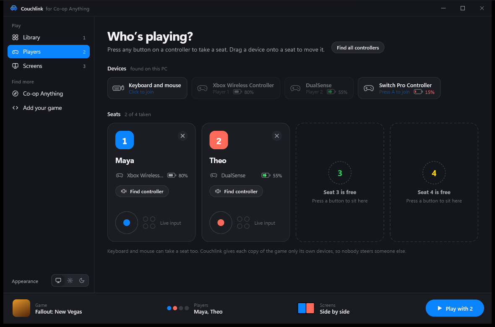
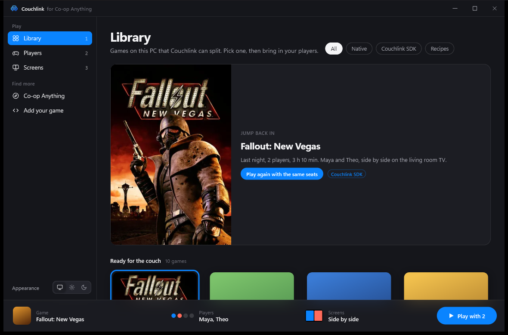
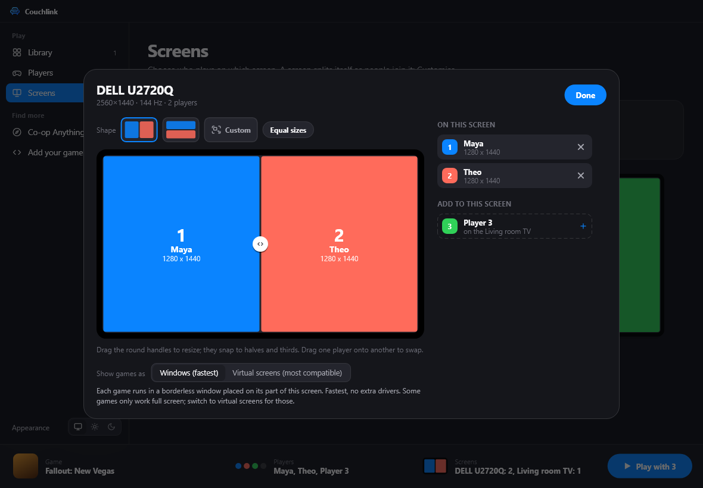
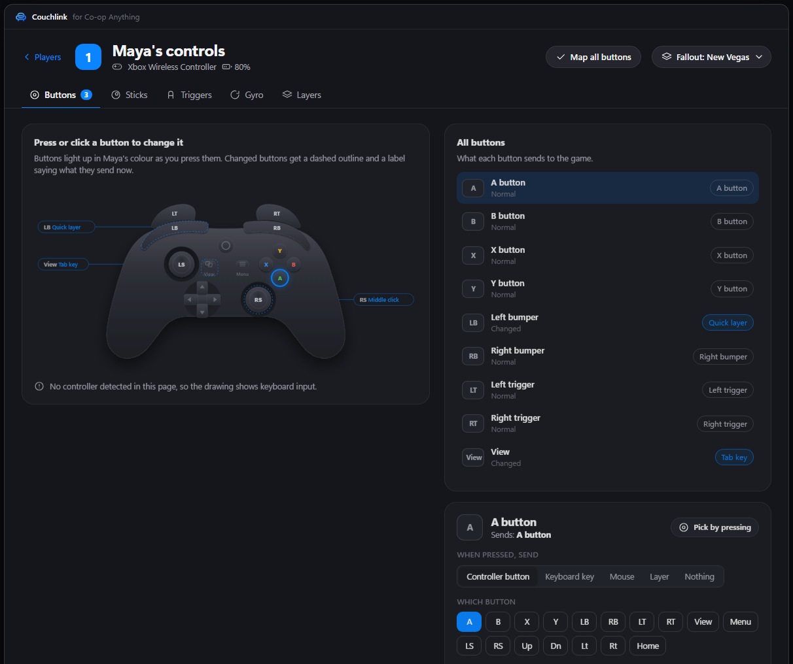

<p align="center">
  
</p>

<p align="center"><b>The couch co-op launcher for PC, and a couch co-op SDK for developers.</b></p>

<p align="center">
<a href="https://github.com/cranebeaker/couchlink/releases">Download</a> ·
<a href="#what-it-does">What it does</a> ·
<a href="#for-developers">For developers</a> ·
<a href="#building">Building</a> ·
<a href="#russian">На русском</a>
</p>

Couchlink runs one copy of a game for each player on the same PC, puts each copy on its own monitor or its own part
of one, and gives each player only their own controller, or their own keyboard and mouse. The copies then connect the
way the game already supports: LAN, a co-op mod's server, or Steam. Any game that plays co-op online is a candidate.

<p align="center">
  
  
</p>
<p align="center">
  
  
</p>

## What it does

**Players and input**
- Up to 8 players per game.
- Controllers, or a keyboard and mouse per player, each locked to its own copy. Press A on a controller or Enter on a
  keyboard to take a seat, or drag any device onto a player.

**Screens**
- One copy per monitor, or split one screen into up to 8.
- Drag, drop and resize to make any layout you like.

**Games and Steam**
- One Steam account is enough: every copy runs under yours, and Steam-only co-op games get a stand-in profile per
  copy (Goldberg emulator).
- Want each player on their own Steam account? One click on their seat, sign in once.
- Every other game on your PC shows up under "Try it", with safe defaults: Steam, GOG, Epic (and Heroic on Linux), or
  any game folder of your own you add in the Library.
- Game copies take no extra disk space, and saves stay per player.
- New co-op recipes sync into the app on their own, signed.

**Under the hood**
- The input hook loads as a stand-in system DLL the game loads itself (like ReShade), so nothing is injected from
  outside. Each copy sees only its own controller through XInput, DirectInput, Raw Input and HID.
- Everything Couchlink changes on your PC is written to a journal first and put back when you stop, also after a
  crash.
- In English and Russian: the app follows your Windows language, and the sidebar has an EN / RU switch.

## Get it

| Platform | Status |
|---|---|
| Windows 10 and 11 (64-bit) | [Releases](https://github.com/cranebeaker/couchlink/releases): unzip, run `couchlink.exe` |
| Linux (64-bit) | [Releases](https://github.com/cranebeaker/couchlink/releases): unpack the `.tar.gz`, run `./couchlink`. Needs nothing beyond a Steam desktop; gamescope (a window per player, a keyboard and mouse per player) is recommended. `LINUX.txt` in the download says what each optional part adds |
| macOS | In the works |

Some antivirus tools are wary of any program that gives games their own controllers. Couchlink is open source and
built from this repo; if your antivirus complains, tell us on the Discord.

## For developers

Get your game into Couchlink, or Couchlink's features into your game or launcher. It is all MIT: take what you need.

Give your coding agent the skill: [`skills/couchlink-sdk/SKILL.md`](skills/couchlink-sdk/SKILL.md).

1. **Write a recipe.** A small JSON file that tells Couchlink how to run your game: the exe and its arguments, where
   saves live, which files each copy needs its own of, how the copies find each other (Steam mode, a server to start
   first) and which single-instance checks to lift. `$SEAT`, `$PLAYER`, `$WIDTH`, `$HEIGHT`, `$X` and `$Y` give each
   copy its own arguments. Format: [`docs/launch.md`](docs/launch.md).
2. **Make your co-op mod Couchlink-aware.** Read the seat, player name and screen region the recipe passes, and join the
   host at `127.0.0.1` on your port. No input tricks needed.
3. **Use Couchlink's parts in your own launcher.** Drive the local service over WebSocket
   ([`docs/protocol.md`](docs/protocol.md)), or take the crates: `couchlink-hook` (per-copy controllers, keyboard and
   mouse), `couchlink-steam` (per-copy Steam), `couchlink-core` (recipes, seats, screens).

## Building

Windows, with Rust, Flutter, CMake and Visual Studio 2022 Build Tools (C++):

```
powershell -File hook/build.ps1
cd core && cargo build --release -p couchlinkd
cd ../app && flutter build windows --release
```

`python -I tools/release/package.py --version 0.1.1` builds the release zip from a neutral folder and checks every file
before writing it. Tests: `cd core && cargo test --workspace` and `cd app && flutter test`.

Layout: `core/` (Rust: the `couchlinkd` service and its crates), `app/` (Flutter), `hook/` (C++ input hook),
`core/recipes/` (built-in recipes), `docs/` (design and protocol).

## License

MIT, see [LICENSE](LICENSE). Third-party code and ideas: [`hook/THIRD_PARTY.md`](hook/THIRD_PARTY.md). Part of
[Co-op Anything](https://github.com/cranebeaker/coop-anything).

---

<a id="russian"></a>

## На русском

**Couchlink: лучший лаунчер для кооператива на одном ПК (и SDK для разработчиков).**

Couchlink запускает отдельную копию игры для каждого игрока на одном компьютере, выводит каждую копию на свой
монитор или на свою часть экрана и даёт каждому игроку только его геймпад, или его собственные клавиатуру и мышь.
Копии соединяются так, как игра уже умеет: по локальной сети, через сервер кооп-мода или через Steam. Подходит любая
игра с онлайн-кооперативом.

**Игроки и управление**
- До 8 игроков в одной игре.
- Геймпад, или клавиатура и мышь для каждого игрока, и каждый управляет только своей копией. Нажмите A на геймпаде
  или Enter на клавиатуре, чтобы занять место, или перетащите устройство на игрока.

**Экраны**
- Одна копия на монитор, или один экран, разделённый на части (до 8).
- Перетаскивайте и меняйте размер, чтобы собрать любую раскладку.

**Игры и Steam**
- Хватит одного аккаунта Steam: все копии работают под вашим, а игры с кооперативом только через Steam получают
  отдельный профиль на каждую копию (эмулятор Goldberg).
- Хотите, чтобы у каждого игрока был свой аккаунт Steam? Один клик по его месту и один вход.
- Все остальные игры на вашем ПК появляются в разделе «Try it» с безопасными настройками: Steam, GOG, Epic (и Heroic
  на Linux) или любая папка с игрой, которую вы добавите в библиотеке.
- Копии игры не занимают лишнего места на диске, сохранения у каждого игрока свои.
- Новые кооп-рецепты сами подтягиваются в приложение, с подписью.
- Приложение на русском: язык берётся из Windows, а в боковой панели есть переключатель EN / RU.

**Скачать**
- Windows 10 и 11 (64-бит): [Releases](https://github.com/cranebeaker/couchlink/releases), распакуйте и запустите
  `couchlink.exe`.
- Linux (64-бит): [Releases](https://github.com/cranebeaker/couchlink/releases), распакуйте `.tar.gz` и запустите
  `./couchlink`. Кроме Steam ничего не нужно; gamescope (своё окно и своя клавиатура с мышью у каждого игрока) рекомендуется.
- macOS: в работе.

**Для разработчиков**

Добавьте свою игру в Couchlink или возьмите возможности Couchlink в свою игру или лаунчер. Всё под лицензией MIT.
Дайте своему ИИ-агенту навык: [`skills/couchlink-sdk/SKILL.md`](skills/couchlink-sdk/SKILL.md).

1. **Напишите рецепт.** Небольшой JSON-файл: какой exe запускать и с какими аргументами, где лежат сохранения, какие
   файлы нужны каждой копии свои, как копии находят друг друга (режим Steam, сервер, который запускается первым), и
   какие проверки на второй запуск снять. Переменные `$SEAT`, `$PLAYER`, `$WIDTH`, `$HEIGHT`, `$X` и `$Y` дают каждой
   копии свои аргументы. Формат: [`docs/launch.md`](docs/launch.md).
2. **Научите свой кооп-мод работать с Couchlink.** Читайте место, имя игрока и область экрана, которые передаёт рецепт,
   и подключайтесь к хосту на `127.0.0.1` на своём порту. Никаких трюков с вводом.
3. **Используйте части Couchlink в своём лаунчере.** Управляйте локальной службой по WebSocket
   ([`docs/protocol.md`](docs/protocol.md)) или берите крейты: `couchlink-hook` (свои геймпады, клавиатура и мышь для
   каждой копии), `couchlink-steam` (Steam для каждой копии), `couchlink-core` (рецепты, места, экраны).
