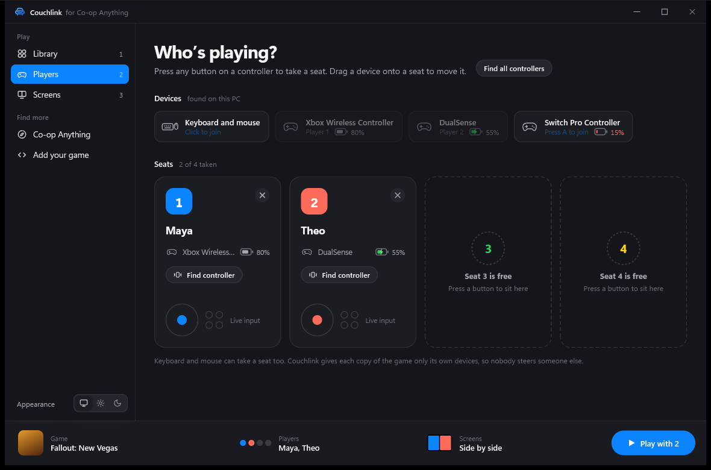
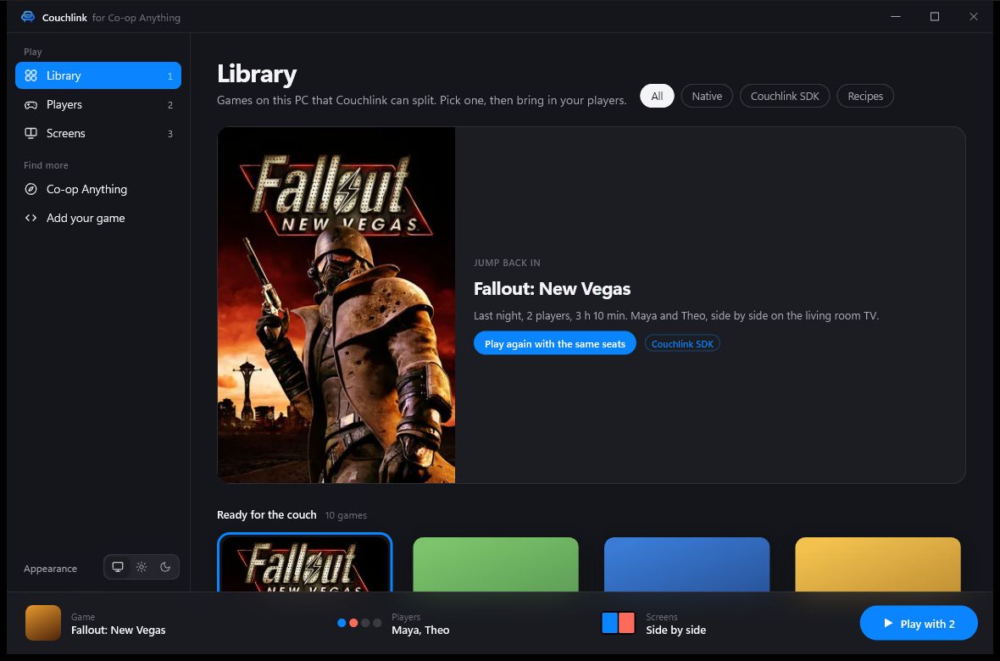
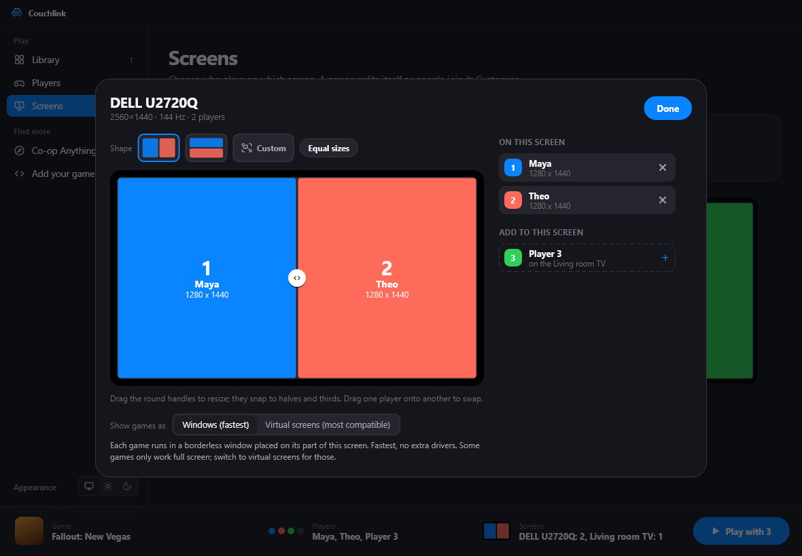
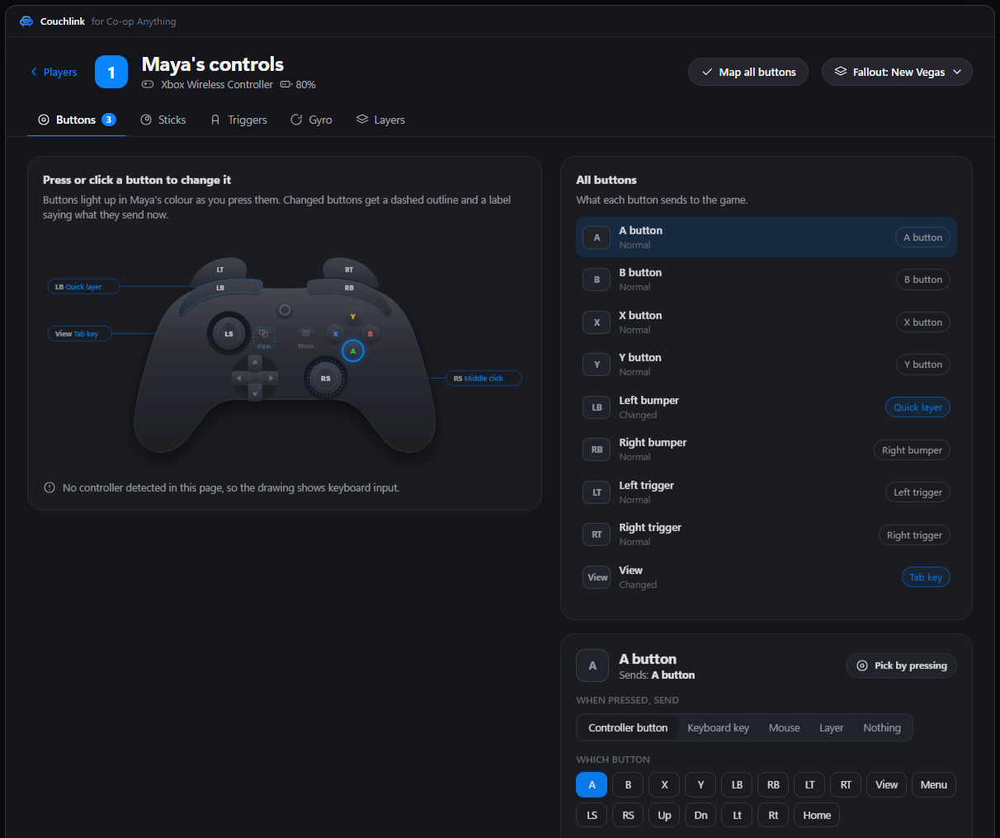

<p align="center">
  
</p>

<p align="center"><b>The ultimate couch co-op launcher (and screen manager) for PC, and a couch co-op SDK for developers.</b></p>

<p align="center">
<a href="https://github.com/cranebeaker/couchlink/releases">Download</a> ·
<a href="#what-it-does">What it does</a> ·
<a href="#for-developers">For developers</a> ·
<a href="#building">Building</a> ·
<a href="#russian">На русском</a>
</p>

Couchlink runs one copy of a game for each player on the same PC, puts each copy on its own monitor or its own part
of one, and gives each player only their own controller, or their own keyboard and mouse. The copies then connect the
way the game already supports: LAN, a co-op mod's server, or Steam. Any game that plays co-op online is a candidate.

<p align="center">
  
  
</p>
<p align="center">
  
  
</p>

## What it does

**Players and input**
- Up to 8 players per game.
- A controller, or a keyboard and mouse, per player, each locked to its own copy. Press A on a controller or Enter on a
  keyboard to take a seat, or drag any device onto a player.
- Couchlink remembers your last setup: devices go back to their seats and players back on their screens, also a
  controller turned on later.
- Move a controller, keyboard or mouse to another player while the games run.
- Remap controls per player, with profiles you can save.
- Controllers: pair one over Bluetooth from the app (Windows), and turn a wireless one off from the app or with a
  button combo.
- Each player gets their own cursor in games that need one, and keys only reach the games while a game is in front, so
  typing in Discord stays in Discord.
- Host control: a keyboard and mouse no player has works in whichever game the pointer is over, handy for a game's
  settings. Ctrl+Shift+K hands every keyboard and mouse to the game under the pointer.

**Screens**
- One copy per monitor, or split one screen into up to 8.
- Drag, drop and resize to make any layout, including free rectangles with gaps.
- Save layouts and pin one to a game, so that game always starts with it.
- Virtual screens (Windows): each player gets a virtual monitor sized to their part of the screen, so games that only
  run full screen still play in split screen.
- Virtual display (Windows): a screen that exists only while you play on it, to stream to a TV with Steam Link and the
  like.
- Shortcuts bring every game window to the front or hide them all, and a frame rate limit holds all copies to the same
  speed.

**Games and Steam**
- One Steam account is enough: every copy runs under yours, and Steam-only co-op games get a stand-in profile per copy
  (Goldberg emulator).
- Want each player on their own Steam account? One click on their seat, sign in once. Games with online-fix play on
  those accounts too.
- Steam's overlay works in every player's copy: Shift+Tab on a player's own keyboard opens friends, invites and
  achievements for that player, and Shift+Tab or Esc closes it.
- Every other game on your PC shows up under "Try it", with safe defaults: Steam, GOG, Epic (and Heroic on Linux), or
  any game folder of your own you add in the Library.
- Start without the recipe: a plain split screen of any game with a recipe, for use with another co-op mod you
  installed yourself.
- Game copies take no extra disk space, and saves stay per player.
- New co-op recipes sync into the app on their own, signed. "Make your own recipe" has a prompt for an AI coding agent
  to write one for your game.

**Start from other apps**
- `couchlink.exe --play <game>` starts a game with the players and screens set up in Couchlink.
- Steps and copy buttons for Steam (including Big Picture), Playnite, LaunchBox and desktop shortcuts.
- A game your launcher starts that Couchlink does not know yet is added on the fly. A switch turns this off.

**Under the hood**
- The input hook loads as a stand-in system DLL the game loads itself (like ReShade), so nothing is injected from
  outside. Each copy sees only its own controller through XInput, DirectInput, Raw Input and HID, with Steam Input on
  or off.
- Everything Couchlink changes on your PC is written to a journal first and put back when you stop, also after a
  crash.
- Updates from inside the app.
- In English, Russian and Brazilian Portuguese: the app follows your system's language, and Settings (the cog at the
  bottom of the sidebar) has an EN / RU / PT switch.

## Get it

| Platform | Status |
|---|---|
| Windows 10 and 11 (64-bit) | [Releases](https://github.com/cranebeaker/couchlink/releases): unzip, run `couchlink.exe` |
| Linux (64-bit) | [Releases](https://github.com/cranebeaker/couchlink/releases): unpack the `.tar.gz`, run `./couchlink`. Needs nothing beyond a Steam desktop; gamescope (a window per player, a keyboard and mouse per player) is recommended. `LINUX.txt` in the download says what each optional part adds |
| macOS | In the works |

The app opens in your system's language (English or Russian). To switch, open Settings (the cog at the bottom of the
sidebar) and pick EN or RU under Language.

Some antivirus tools are wary of any program that gives games their own controllers. Couchlink is open source and
built from this repo; if your antivirus complains, tell us on the Discord.

## For developers

Get your game into Couchlink, or Couchlink's features into your game or launcher. It is all MIT: take what you need.

Give your coding agent the skill: [`skills/couchlink-sdk/SKILL.md`](skills/couchlink-sdk/SKILL.md).

1. **Write a recipe.** A small JSON file that tells Couchlink how to run your game: the exe and its arguments, where
   saves live, which files each copy needs its own of, how the copies find each other (Steam mode, a server to start
   first) and which single-instance checks to lift. `$SEAT`, `$PLAYER`, `$WIDTH`, `$HEIGHT`, `$X` and `$Y` give each
   copy its own arguments. Format: [`docs/launch.md`](docs/launch.md).
2. **Make your co-op mod Couchlink-aware.** Read the seat, player name and screen region the recipe passes, and join the
   host at `127.0.0.1` on your port. No input tricks needed.
3. **Use Couchlink's parts in your own launcher.** Drive the local service over WebSocket
   ([`docs/protocol.md`](docs/protocol.md)), or take the crates: `couchlink-hook` (per-copy controllers, keyboard and
   mouse), `couchlink-steam` (per-copy Steam), `couchlink-core` (recipes, seats, screens).

## Building

Windows, with Rust, Flutter, CMake and Visual Studio 2022 Build Tools (C++):

```
powershell -File hook/build.ps1
cd core && cargo build --release -p couchlinkd
cd ../app && flutter build windows --release
```

`python -I tools/release/package.py --version 0.1.21` builds the release zip from a neutral folder and checks every file
before writing it. Tests: `cd core && cargo test --workspace` and `cd app && flutter test`.

Layout: `core/` (Rust: the `couchlinkd` service and its crates), `app/` (Flutter), `hook/` (C++ input hook),
`core/recipes/` (built-in recipes), `docs/` (design and protocol).

## License

MIT, see [LICENSE](LICENSE). Third-party code and ideas: [`hook/THIRD_PARTY.md`](hook/THIRD_PARTY.md). Part of
[Co-op Anything](https://github.com/cranebeaker/coop-anything).

---

<a id="russian"></a>

## На русском

**Couchlink: лучший лаунчер для кооператива на одном ПК (и SDK для разработчиков).**

Couchlink запускает отдельную копию игры для каждого игрока на одном компьютере, выводит каждую копию на свой
монитор или на свою часть экрана и даёт каждому игроку только его геймпад, или его собственные клавиатуру и мышь.
Копии соединяются так, как игра уже умеет: по локальной сети, через сервер кооп-мода или через Steam. Подходит любая
игра с онлайн-кооперативом.

**Игроки и управление**
- До 8 игроков в одной игре.
- Геймпад, или клавиатура и мышь для каждого игрока, и каждый управляет только своей копией. Нажмите A на геймпаде
  или Enter на клавиатуре, чтобы занять место, или перетащите устройство на игрока.
- Couchlink помнит последнюю настройку: устройства возвращаются на свои места, а игроки на свои экраны, даже если
  геймпад включили позже.
- Геймпад, клавиатуру или мышь можно передать другому игроку прямо во время игры.
- Своя раскладка управления у каждого игрока, с профилями, которые можно сохранять.
- Геймпады: сопряжение по Bluetooth прямо из приложения (Windows), беспроводной можно выключить из приложения или
  сочетанием кнопок.
- У каждого игрока свой курсор в играх, где он нужен, а нажатия доходят до игр, только пока игра на переднем плане,
  так что текст в Discord остаётся в Discord.
- Управление хоста: клавиатура и мышь, которые не заняты игроками, работают в той игре, над которой указатель, это
  удобно для настроек игры. Ctrl+Shift+K отдаёт все клавиатуры и мыши игре под указателем.

**Экраны**
- Одна копия на монитор, или один экран, разделённый на части (до 8).
- Перетаскивайте и меняйте размер, чтобы собрать любую раскладку, в том числе свободные прямоугольники с промежутками.
- Сохраняйте раскладки и закрепляйте их за играми, чтобы игра всегда запускалась с нужной.
- Виртуальные экраны (Windows): каждый игрок получает виртуальный монитор размером со свою часть экрана, поэтому игры
  только с полноэкранным режимом тоже работают на разделённом экране.
- Виртуальный дисплей (Windows): экран, который существует только пока вы на нём играете, для трансляции на телевизор
  через Steam Link и похожие программы.
- Сочетания клавиш выводят все окна игр на передний план или прячут их, а ограничение частоты кадров держит все копии
  на одной скорости.

**Игры и Steam**
- Хватит одного аккаунта Steam: все копии работают под вашим, а игры с кооперативом только через Steam получают
  отдельный профиль на каждую копию (эмулятор Goldberg).
- Хотите, чтобы у каждого игрока был свой аккаунт Steam? Один клик по его месту и один вход. Игры с online-fix тоже
  работают на этих аккаунтах.
- Оверлей Steam работает в копии каждого игрока: Shift+Tab на клавиатуре игрока открывает друзей, приглашения и
  достижения этого игрока, а Shift+Tab или Esc закрывает.
- Все остальные игры на вашем ПК появляются в разделе «Try it» с безопасными настройками: Steam, GOG, Epic (и Heroic
  на Linux) или любая папка с игрой, которую вы добавите в библиотеке.
- Запуск без рецепта: обычный разделённый экран для любой игры с рецептом, например с другим кооп-модом, который вы
  поставили сами.
- Копии игры не занимают лишнего места на диске, сохранения у каждого игрока свои.
- Новые кооп-рецепты сами подтягиваются в приложение, с подписью. В разделе «Make your own recipe» есть запрос для
  ИИ-агента, который напишет рецепт для вашей игры.

**Запуск из других программ**
- `couchlink.exe --play <игра>` запускает игру с игроками и экранами, настроенными в Couchlink.
- Шаги и кнопки копирования для Steam (включая Big Picture), Playnite, LaunchBox и ярлыков на рабочем столе.
- Игра, которую запускает ваш лаунчер и которой ещё нет в Couchlink, добавляется сама. Это можно выключить.

**Внутри**
- Модуль ввода загружается как подменная системная DLL, которую игра грузит сама (как ReShade), поэтому ничего не
  внедряется снаружи. Каждая копия видит только свой геймпад через XInput, DirectInput, Raw Input и HID, со Steam Input
  и без него.
- Всё, что Couchlink меняет на вашем ПК, сначала записывается в журнал и возвращается назад при остановке, даже после
  сбоя.
- Обновления прямо из приложения.
- Приложение на русском: язык берётся из системы, а в настройках (шестерёнка внизу боковой панели) есть
  переключатель EN / RU.

**Скачать**
- Windows 10 и 11 (64-бит): [Releases](https://github.com/cranebeaker/couchlink/releases), распакуйте и запустите
  `couchlink.exe`.
- Linux (64-бит): [Releases](https://github.com/cranebeaker/couchlink/releases), распакуйте `.tar.gz` и запустите
  `./couchlink`. Кроме Steam ничего не нужно; gamescope (своё окно и своя клавиатура с мышью у каждого игрока) рекомендуется.
- macOS: в работе.
- Как включить русский: если система на русском, приложение сразу откроется на русском. Если нет, нажмите
  шестерёнку внизу боковой панели и выберите RU в разделе «Язык».

**Для разработчиков**

Добавьте свою игру в Couchlink или возьмите возможности Couchlink в свою игру или лаунчер. Всё под лицензией MIT.
Дайте своему ИИ-агенту навык: [`skills/couchlink-sdk/SKILL.md`](skills/couchlink-sdk/SKILL.md).

1. **Напишите рецепт.** Небольшой JSON-файл: какой exe запускать и с какими аргументами, где лежат сохранения, какие
   файлы нужны каждой копии свои, как копии находят друг друга (режим Steam, сервер, который запускается первым), и
   какие проверки на второй запуск снять. Переменные `$SEAT`, `$PLAYER`, `$WIDTH`, `$HEIGHT`, `$X` и `$Y` дают каждой
   копии свои аргументы. Формат: [`docs/launch.md`](docs/launch.md).
2. **Научите свой кооп-мод работать с Couchlink.** Читайте место, имя игрока и область экрана, которые передаёт рецепт,
   и подключайтесь к хосту на `127.0.0.1` на своём порту. Никаких трюков с вводом.
3. **Используйте части Couchlink в своём лаунчере.** Управляйте локальной службой по WebSocket
   ([`docs/protocol.md`](docs/protocol.md)) или берите крейты: `couchlink-hook` (свои геймпады, клавиатура и мышь для
   каждой копии), `couchlink-steam` (Steam для каждой копии), `couchlink-core` (рецепты, места, экраны).
